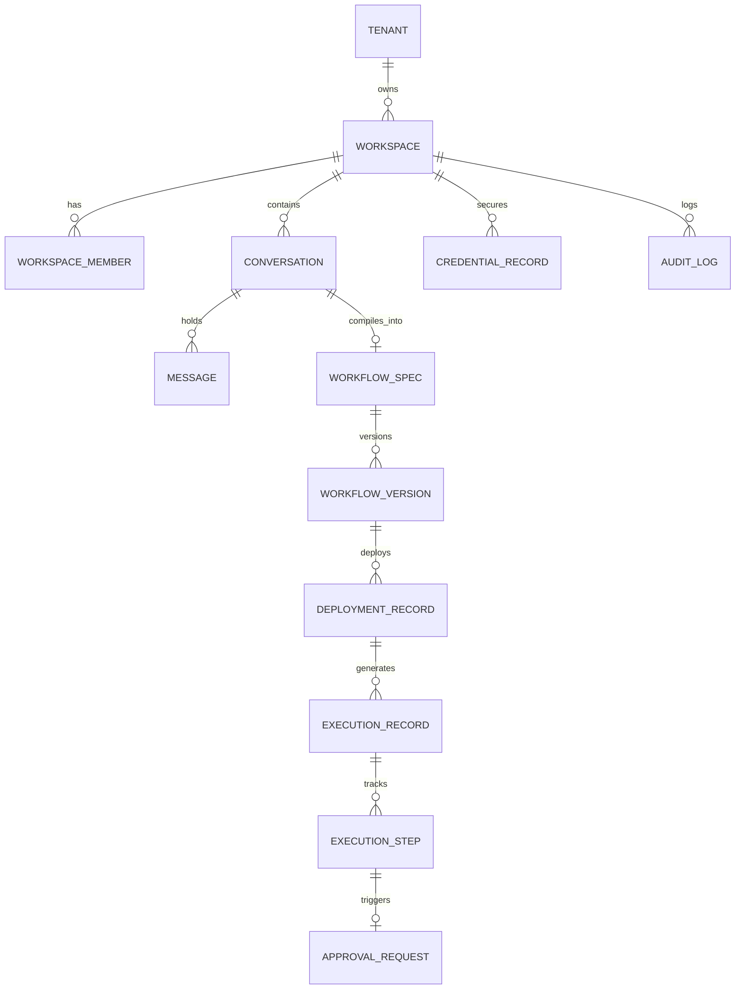

# QuickReply AI Automation Operating System — Database Design & Schema Specification

**Document Version:** 2.0  
**Storage Engine:** MongoDB Atlas (M10+ Multi-Region Cluster) + In-Memory Atomic Cache  
**Isolation Architecture:** Cryptographic Tenant Partitioning  

---

## 1. Domain Entities & Entity-Relationship Model



---

## 2. Core Schema Definitions

### 2.1 Conversations & Messages (`conversations`, `messages`)
```typescript
export interface Conversation {
  id: string;                      // conv_<uuid>
  tenantId: string;                // Cryptographic tenant identifier
  workspaceId: string;             // ws_<uuid>
  title: string;                   // E.g., "Invoice processing to Sheets"
  status: "ACTIVE" | "ARCHIVED";
  createdAt: string;
  updatedAt: string;
  lastMessageAt: string;
  activeWorkflowId?: string;       // Linked workflow under design
}

export interface ConversationMessage {
  id: string;                      // msg_<uuid>
  conversationId: string;
  tenantId: string;
  role: "user" | "assistant" | "system";
  content: string;
  parts?: Array<{
    type: "text" | "clarification_prompt" | "workflow_preview" | "approval_card" | "test_result";
    payload: Record<string, any>;
  }>;
  createdAt: string;
}
```

### 2.2 Normalized Workflow Specification (`workflow_specs`, `workflow_versions`)
```typescript
export interface WorkflowSpec {
  id: string;                      // wf_<uuid>
  tenantId: string;
  workspaceId: string;
  name: string;
  description: string;
  businessObjective: string;
  runtimeTarget: "n8n" | "langgraph" | "native" | "hybrid";
  version: number;
  status: "DRAFT" | "REQUIREMENTS_COMPLETE" | "VALIDATED" | "ACTIVE" | "PAUSED" | "ARCHIVED";
  trigger: {
    type: "schedule" | "webhook" | "event" | "manual";
    appId: string;                 // e.g. "gmail", "stripe", "clock"
    config: Record<string, any>;
  };
  steps: Array<{
    id: string;
    appId: string;                 // e.g. "google_sheets", "telegram"
    actionId: string;              // e.g. "append_row", "send_message"
    label: string;
    credentialRef: string;         // e.g. "cred_gmail_01" (NEVER secret string)
    parameters: Record<string, any>;
    dependsOn: string[];
    sideEffect: "SAFE_READ" | "REVERSIBLE" | "EXTERNAL_COMMUNICATION" | "FINANCIAL" | "DESTRUCTIVE";
    approvalRequired: boolean;
  }>;
  retryPolicy: {
    maxAttempts: number;
    backoffMs: number;
  };
  createdAt: string;
  updatedAt: string;
  deployedAt?: string;
}
```

### 2.3 Secure Credential Vault (`credentials_vault`)
```typescript
export interface SecureCredentialRecord {
  id: string;                      // cred_<uuid>
  tenantId: string;
  workspaceId: string;
  appId: string;                   // e.g. "gmail", "google_sheets", "telegram"
  authType: "oauth2" | "api_key" | "webhook_secret";
  accountLabel: string;            // e.g. "Finance Dept Gmail"
  encryptedData: string;           // AES-256-GCM format "iv:authTag:ciphertext"
  scopes: string[];
  status: "ACTIVE" | "EXPIRED" | "REVOKED";
  expiresAt?: string;
  createdAt: string;
  updatedAt: string;
}
```

### 2.4 Execution & Telemetry Records (`executions`, `execution_steps`)
```typescript
export interface WorkflowExecutionRecord {
  id: string;                      // exec_<uuid>
  tenantId: string;
  workspaceId: string;
  workflowId: string;
  workflowVersion: number;
  deploymentId: string;
  runtimeProvider: "n8n" | "langgraph" | "native";
  status: "QUEUED" | "RUNNING" | "WAITING_APPROVAL" | "COMPLETED" | "FAILED" | "CANCELLED";
  triggerPayload: Record<string, any>;
  startedAt: string;
  completedAt?: string;
  latencyMs?: number;
  steps: Array<{
    stepId: string;
    label: string;
    status: "SUCCESS" | "FAILED" | "SKIPPED" | "WAITING_APPROVAL";
    latencyMs: number;
    inputSummary: Record<string, any>;
    outputSummary?: Record<string, any>;
    error?: string;
  }>;
  error?: string;
}
```

---

## 3. Database Indexes for High-Concurrency Performance

| Collection | Indexed Fields | Type | Purpose |
|---|---|---|---|
| `conversations` | `{ tenantId: 1, updatedAt: -1 }` | Compound | Fast session listing per tenant |
| `messages` | `{ conversationId: 1, createdAt: 1 }` | Compound | Fast sequential chat retrieval |
| `workflow_specs` | `{ tenantId: 1, status: 1 }` | Compound | Fast workflow query by status |
| `executions` | `{ tenantId: 1, workflowId: 1, startedAt: -1 }` | Compound | Execution history & telemetry queries |
| `credentials_vault` | `{ tenantId: 1, appId: 1 }` | Compound | Integration lookup & credential resolution |
| `approval_requests` | `{ tenantId: 1, status: 1, createdAt: -1 }` | Compound | Pending human-in-the-loop review queue |

---

## 4. Multi-Tenant Partitioning & Data Isolation

1. **Logical Partitioning:** Every query MUST provide `tenantId` in the filter predicate.
2. **Deterministic Canonical Tenant ID:** `getCanonicalTenantId(email)` enforces lowercased, sanitized tenant boundaries without trusting browser-supplied headers.
3. **Automated Migration Strategy:** All schema changes are versioned and backward-compatible with progressive field defaulting in `db.ts` upon deserialization.