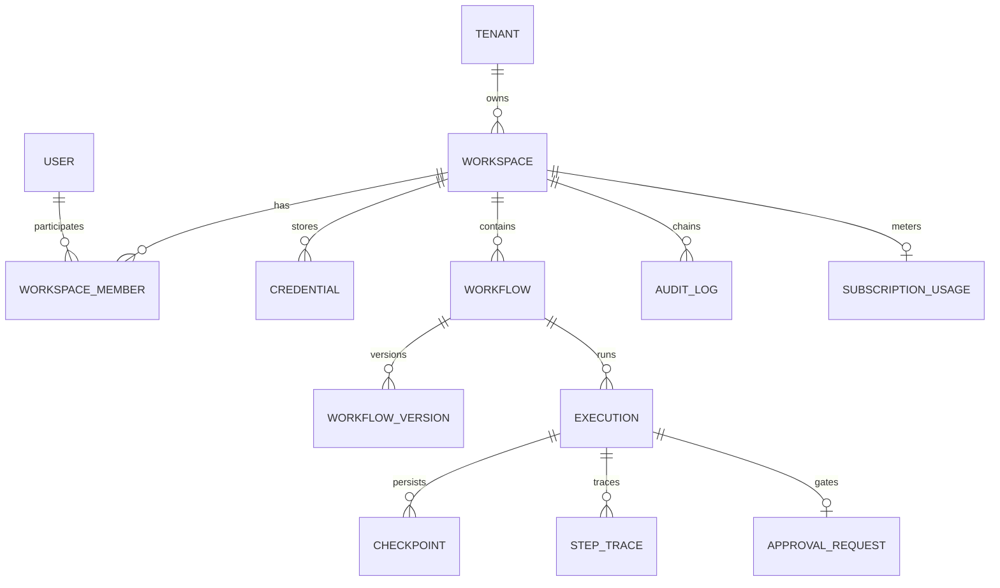

# QuickReply Multi-Tenant Database Architecture & Schema Specification

**Document Version:** 3.0  
**Status:** Canonical Living Engineering Specification  
**Classification:** Core Data Architecture Specification  
**Storage Engines:** MongoDB Atlas Driver 7.5.0, Redis 5.11.1, On-Disk Atomic JSON Fallback (`src/data/`)  
**Isolation Architecture:** Cryptographic Tenant Partitioning & Workspace Namespacing  
**Last Updated:** 2026-11-01  

---

## 1. Architectural Overview & Storage Topology

QuickReply employs a **multi-tiered storage architecture** combining production-grade document persistence, low-latency caching, and an automated file-based fallback engine for hermetic local environments:

```
┌────────────────────────────────────────────────────────────────────────────────────────┐
│                                 STORAGE ROUTING TOPOLOGY                               │
├────────────────────────────────────────────────────────────────────────────────────────┤
│                                 API / ENGINE LAYER                                     │
│                                          │                                             │
│                                   `getDB(tenantId)`                                    │
│                                          │                                             │
│                 ┌────────────────────────┴────────────────────────┐                    │
│                 ▼                                                 ▼                    │
│      [Production Cluster Mode]                        [Local / Offline Mode]           │
│     (when MONGODB_URI is set)                         (when MONGODB_URI is unset)       │
│                 │                                                 │                    │
│     ┌───────────┴───────────┐                         ┌───────────┴───────────┐        │
│     ▼                       ▼                         ▼                       ▼        │
│ ┌───────────────┐   ┌───────────────┐             ┌───────────────┐   ┌──────────────┐ │
│ │ MongoDB Atlas │   │  Redis Cache  │             │ File Fallback │   │ In-Memory    │ │
│ │ Driver Pool   │   │  (TTL = 60s)  │             │ Atomic Sync   │   │ State Store  │ │
│ │ (maxPool: 50) │   │ Read-Through  │             │ `db_<tid>.json│   │ Fast Lookup  │ │
│ └───────────────┘   └───────────────┘             └───────────────┘   └──────────────┘ │
└────────────────────────────────────────────────────────────────────────────────────────┘
```

### 1.1 Tenant Partitioning Model
Every record in the system contains a cryptographic `tenantId` and a hierarchical `workspaceId`:
- **Canonical Tenant ID**: Computed via SHA-256 derivation:
  $$\text{tenantId} = \text{"tenant\_"} + \text{SHA256}(\text{ownerEmail} \lor \text{accountId})[0..15]$$
- **Workspace ID**: Opaque UUID formatted as `ws_<uuidv4>`.
- **Database Partitioning**:
  - In MongoDB Atlas: Queries are strictly filtered by `{ tenantId, workspaceId }`.
  - In File Fallback Mode: Stored as isolated tenant documents in `src/data/db_<tenantId>.json`.

---

## 2. Entity-Relationship Model (ERD)



---

## 3. Core Schema Specifications

### 3.1 Workspaces & Workspace Members

```typescript
export type WorkspaceRole =
  | "OWNER"       // Full root access, billing, workspace deletion, audit export
  | "ADMIN"       // Manage members, configure integrations, manage credentials
  | "MEMBER"      // General access, run workflows, view history
  | "EDITOR"      // Canvas designer: create, edit, save workflows and parameters
  | "OPERATOR"    // Production operator: manual triggers, resume runs, approvals
  | "DEVELOPER"   // Custom scripts, webhook configuration, API key access
  | "VIEWER";     // Read-only inspection of workflows, executions, and metrics

export interface Workspace {
  _id?: string;
  id: string;                          // ws_<uuidv4>
  tenantId: string;                    // tenant_<sha256_16>
  name: string;                        // e.g. "Acme Production Operations"
  slug: string;                        // e.g. "acme-prod-ops"
  planTier: "FREE_SANDBOX" | "STARTER" | "PRO" | "ENTERPRISE";
  settings: {
    enforceMfa: boolean;
    ipWhitelist: string[];
    defaultTimezone: string;           // e.g. "America/New_York", "UTC"
    dataRetentionDays: number;         // e.g. 90
    maxConcurrentExecutions: number;   // e.g. 15
  };
  createdAt: string;                   // ISO 8601
  updatedAt: string;                   // ISO 8601
}

export interface WorkspaceMember {
  id: string;                          // wsm_<uuidv4>
  workspaceId: string;
  tenantId: string;
  userId: string;                      // usr_<uuidv4>
  email: string;
  role: WorkspaceRole;
  status: "ACTIVE" | "INVITED" | "SUSPENDED";
  invitedBy?: string;
  joinedAt?: string;
  updatedAt: string;
}
```

### 3.2 Users & Authentication Sessions

```typescript
export interface User {
  _id?: string;
  id: string;                          // usr_<uuidv4>
  email: string;                       // Unique index
  passwordHash?: string;               // bcrypt (12 rounds)
  name: string;
  avatarUrl?: string;
  defaultTenantId: string;
  defaultWorkspaceId: string;
  mfaEnabled: boolean;
  mfaSecret?: string;                  // Encrypted with AES-256-GCM
  createdAt: string;
  updatedAt: string;
}

export interface UserSession {
  sessionId: string;                   // sess_<uuidv4>
  userId: string;
  tenantId: string;
  workspaceId: string;
  role: WorkspaceRole;
  userAgent: string;
  ipAddress: string;
  expiresAt: string;                   // ISO 8601
  createdAt: string;
}
```

### 3.3 Credential Vault (`credentials`)

Secrets are encrypted at rest with AES-256-GCM. Workflows reference only `credentialId`.

```typescript
export interface CredentialRecord {
  _id?: string;
  id: string;                          // cred_<uuidv4>
  tenantId: string;
  workspaceId: string;
  appId: string;                       // e.g. "google_sheets", "gmail", "slack", "canva", "hubspot"
  accountLabel: string;                // e.g. "Acme Marketing Google Workspace"
  authType: "oauth2" | "api_key" | "webhook_secret" | "basic";
  
  // Encrypted Payload (AES-256-GCM ciphertext: "iv_hex:authTag_hex:ciphertext_hex")
  encryptedData: string;
  
  // Metadata for OAuth 2.0 lifecycle management (non-secret fields)
  oauthMetadata?: {
    tokenEndpoint: string;
    clientId: string;
    scopes: string[];
    expiresAt?: string;                // ISO 8601 timestamp for auto-refresh
    lastRefreshedAt?: string;
    refreshError?: string;
  };
  
  status: "ACTIVE" | "EXPIRED" | "REVOKED" | "ERROR";
  createdAt: string;
  updatedAt: string;
  createdBy: string;
}
```

### 3.4 Workflows & Version History (`workflows`, `workflow_versions`)

```typescript
export interface WorkflowDefinitionV3 {
  schemaVersion: "3.0.0";
  id: string;                          // wf_<uuidv4>
  tenantId: string;
  workspaceId: string;
  name: string;
  description: string;
  version: number;                     // Monotonically increasing
  status: "DRAFT" | "ACTIVE" | "PAUSED" | "ARCHIVED";
  runtimeTarget: "native" | "n8n" | "langgraph";
  
  // Canvas Viewport & Layout Metadata
  viewport?: {
    x: number;
    y: number;
    zoom: number;
  };
  
  // Triggers (Webhook, Cron, Event, Manual)
  triggers: Array<{
    id: string;                        // trg_<uuidv4>
    type: "webhook" | "cron" | "manual" | "event";
    appId: string;                     // e.g. "webhook", "clock", "gmail"
    config: {
      cronExpression?: string;         // e.g. "0 9 * * *"
      timezone?: string;
      webhookPath?: string;            // e.g. "/api/webhooks/automation/leads"
      webhookMethod?: "POST" | "GET";
      signatureSecretRef?: string;     // cred_<uuidv4>
      filterEvent?: string;
    };
  }>;
  
  // Nodes (2D Canvas & Executable Steps)
  nodes: Array<{
    id: string;                        // step_<uuidv4>
    type: "triggerNode" | "actionNode" | "conditionNode" | "loopNode" | "aiNode" | "customScriptNode";
    name: string;                      // Display label
    appId: string;                     // e.g. "google_sheets", "anthropic"
    actionId: string;                  // e.g. "append_row", "messages_create"
    credentialRef?: string;            // cred_<uuidv4>
    parameters: Record<string, any>;   // Dynamic parameters
    position: { x: number; y: number };// 2D coordinates for canvas rendering
    
    // Node-Level Execution & Governance Policies
    policies?: {
      retryPolicy?: {
        maxAttempts: number;           // Default: 3
        initialIntervalMs: number;     // Default: 1000
        maxIntervalMs: number;         // Default: 60000
        backoffMultiplier: number;     // Default: 2.0
      };
      timeoutMs?: number;              // Default: 30000
      requiresApproval?: boolean;
      approvalCondition?: string;      // AST Expression (e.g. "$json.amount > 50000")
      riskLevel?: "SAFE_READ" | "REVERSIBLE" | "EXTERNAL_COMMUNICATION" | "FINANCIAL" | "DESTRUCTIVE";
    };
  }>;
  
  // Directed Graph Edges & Routing Handles
  edges: Array<{
    id: string;                        // edge_<uuidv4>
    source: string;                    // Source Node ID
    target: string;                    // Target Node ID
    sourceHandle?: "source" | "true" | "false" | "loop_body" | "completed";
    targetHandle?: "target";
    label?: string;
    conditionExpression?: string;      // Optional inline AST filter
  }>;
  
  createdAt: string;
  updatedAt: string;
  createdBy: string;
}

export interface WorkflowVersion {
  id: string;                          // wfv_<uuidv4>
  workflowId: string;
  version: number;
  tenantId: string;
  workspaceId: string;
  definition: WorkflowDefinitionV3;
  changeSummary: string;               // e.g. "Added conditional branch for VIP alerts"
  committedBy: string;
  createdAt: string;
}
```

### 3.5 Checkpoints & Crash Recovery (`checkpoints`)

Atomic checkpoints persisted across node state transitions to guarantee durability and crash resumption.

```typescript
export interface ExecutionCheckpoint {
  _id?: string;
  executionId: string;                 // exec_<uuidv4>
  tenantId: string;
  workspaceId: string;
  workflowId: string;
  workflowVersion: number;
  
  // State Machine Status
  status: "QUEUED" | "STARTED" | "RUNNING" | "WAITING_APPROVAL" | "WAITING_RETRY" | "COMPLETED" | "FAILED";
  
  // Traversal Frontiers
  currentNodeId: string | null;
  completedNodeIds: string[];
  pendingNodeIds: string[];
  skippedNodeIds: string[];
  
  // State Payloads
  nodeOutputs: Record<string, any>;    // Keyed by nodeId (step_<uuid>)
  accumulatedState: Record<string, any>; // Combined execution context ($json, $node, $env)
  
  // Retry Tracking
  retryState: Record<string, {
    attemptCount: number;
    nextRetryAt: string;
    lastError: string;
  }>;
  
  // Liveness Heartbeat for Crash Recovery
  lastHeartbeatAt: string;             // ISO 8601
  createdAt: string;
  updatedAt: string;
}
```

### 3.6 Executions & Step Traces (`executions`, `step_traces`)

```typescript
export interface ExecutionRecord {
  _id?: string;
  id: string;                          // exec_<uuidv4>
  tenantId: string;
  workspaceId: string;
  workflowId: string;
  workflowVersion: number;
  triggerType: "webhook" | "cron" | "manual" | "event";
  triggerPayload: Record<string, any>;
  
  status: "QUEUED" | "STARTED" | "RUNNING" | "WAITING_APPROVAL" | "COMPLETED" | "FAILED" | "CANCELLED";
  startedAt: string;
  completedAt?: string;
  durationMs?: number;
  
  // Aggregated Telemetry
  metrics: {
    totalSteps: number;
    completedSteps: number;
    failedSteps: number;
    retriedSteps: number;
    tokensConsumed?: number;
    estimatedCostUsd?: number;
  };
  
  error?: {
    failedNodeId: string;
    nodeType: string;
    message: string;
    stack?: string;
    isRetryable: boolean;
  };
  
  // AI Debugger Output (if failed)
  aiDiagnosis?: {
    rootCause: string;
    remediationSteps: string[];
    suggestedPatch?: Record<string, any>;
  };
  
  createdAt: string;
  updatedAt: string;
}

export interface ExecutionStepTrace {
  id: string;                          // trace_<uuidv4>
  executionId: string;
  nodeId: string;
  nodeName: string;
  appId: string;
  actionId: string;
  status: "SUCCESS" | "FAILED" | "SKIPPED" | "RETRYING";
  startedAt: string;
  completedAt: string;
  durationMs: number;
  inputPayload: Record<string, any>;   // Secret-redacted
  outputPayload: Record<string, any>;  // Secret-redacted
  errorDetails?: {
    message: string;
    code?: string;
    httpStatus?: number;
  };
  assertionsEvaluated?: Array<{
    assertion: string;
    passed: boolean;
    observedValue: any;
  }>;
}
```

### 3.7 Human Approval Workflows (`approval_requests`)

```typescript
export interface ApprovalRequest {
  _id?: string;
  id: string;                          // appr_<uuidv4>
  tenantId: string;
  workspaceId: string;
  executionId: string;
  workflowId: string;
  nodeId: string;
  actionLabel: string;
  riskLevel: "SAFE_READ" | "REVERSIBLE" | "EXTERNAL_COMMUNICATION" | "FINANCIAL" | "DESTRUCTIVE";
  
  proposedPayload: Record<string, any>;// Exact parameters pending dispatch
  status: "PENDING" | "APPROVED" | "REJECTED" | "EXPIRED";
  
  decidedBy?: string;                  // User ID who approved/rejected
  decisionTimestamp?: string;
  rejectionReason?: string;
  expiresAt: string;                   // ISO 8601 (e.g. 24 hours after creation)
  createdAt: string;
}
```

### 3.8 Tamper-Evident Audit Logs (`audit_logs`)

All security-relevant actions are cryptographically chained using SHA-256:

$$\text{Chain Invariant: } H_n = \text{SHA256}(H_{n-1} \,\|\, \text{timestamp} \,\|\, \text{tenantId} \,\|\, \text{eventType} \,\|\, \text{userId} \,\|\, \text{canonicalDetails})$$

```typescript
export interface AuditLogEntry {
  _id?: string;
  id: string;                          // log_<uuidv4>
  sequenceNumber: number;              // Monotonically increasing per workspace (1, 2, 3...)
  tenantId: string;
  workspaceId: string;
  userId: string;
  eventType:
    | "USER_LOGIN"
    | "CREDENTIAL_CREATED"
    | "CREDENTIAL_ACCESSED"
    | "CREDENTIAL_ROTATED"
    | "WORKFLOW_CREATED"
    | "WORKFLOW_UPDATED"
    | "WORKFLOW_DEPLOYED"
    | "WORKFLOW_EXECUTED"
    | "APPROVAL_GRANTED"
    | "APPROVAL_REJECTED"
    | "CROSS_TENANT_ACCESS_DENIED"
    | "QUOTA_EXCEEDED"
    | "SCRIPT_SANDBOX_TIMEOUT";
  
  resourceType: string;                // e.g. "workflow", "credential", "execution"
  resourceId: string;
  ipAddress: string;
  userAgent: string;
  details: Record<string, any>;        // Redacted payload
  
  // Cryptographic Proof Fields
  previousHash: string;                // H_{n-1} ("GENESIS_HASH" for record #1)
  recordHash: string;                  // H_n
  timestamp: string;                   // ISO 8601
}
```

### 3.9 SaaS Subscription & Usage Quota Ledger (`subscriptions`, `usage_ledgers`)

```typescript
export interface SubscriptionUsageLedger {
  tenantId: string;
  workspaceId: string;
  billingPeriodMonth: string;          // e.g. "2026-11"
  planTier: "FREE_SANDBOX" | "STARTER" | "PRO" | "ENTERPRISE";
  
  limits: {
    maxMonthlyExecutions: number;      // e.g. Free: 100, Starter: 1000, Pro: 10000, Ent: Unlimited
    maxConcurrentRuns: number;         // e.g. Free: 2, Starter: 5, Pro: 15, Ent: 100
    maxWorkflows: number;              // e.g. Free: 5, Starter: 20, Pro: 100, Ent: Unlimited
    allowCustomScriptNodes: boolean;
    allowCanvaConnect: boolean;
  };
  
  usage: {
    monthlyExecutionsCount: number;
    activeWorkflowCount: number;
    peakConcurrentExecutions: number;
    totalTokensConsumed: number;
    estimatedCostUsd: number;
  };
  
  updatedAt: string;
}
```

---

## 4. Indexing Strategy & Performance Optimization

To guarantee sub-10ms queries at multi-tenant scale, the following compound and unique indexes are defined in MongoDB Atlas:

| Collection | Index Name | Fields | Properties | Purpose |
|---|---|---|---|---|
| `users` | `idx_users_email` | `{ email: 1 }` | `unique: true` | Fast user login & authentication |
| `workspaces` | `idx_workspaces_tenant` | `{ tenantId: 1, id: 1 }` | `unique: true` | Tenant partition enforcement |
| `credentials` | `idx_credentials_lookup`| `{ workspaceId: 1, appId: 1, status: 1 }` | Standard | Credential selector dropdowns |
| `credentials` | `idx_credentials_token` | `{ "oauthMetadata.expiresAt": 1 }` | Standard | Background token refresh daemon |
| `workflows` | `idx_workflows_ws` | `{ workspaceId: 1, status: 1, updatedAt: -1 }`| Standard | Dashboard workflow listing |
| `checkpoints` | `idx_checkpoints_exec` | `{ executionId: 1 }` | `unique: true` | Atomic checkpoint updates |
| `checkpoints` | `idx_checkpoints_crash`| `{ status: 1, lastHeartbeatAt: 1 }` | Standard | Boot-time crash recovery scan |
| `executions` | `idx_executions_ws` | `{ workspaceId: 1, createdAt: -1 }` | Standard | Real-time execution dashboard |
| `executions` | `idx_executions_wf` | `{ workflowId: 1, status: 1 }` | Standard | Workflow run history & telemetry |
| `step_traces` | `idx_traces_exec` | `{ executionId: 1, startedAt: 1 }` | Standard | Canvas execution trace drawer |
| `audit_logs` | `idx_audit_chain` | `{ workspaceId: 1, sequenceNumber: 1 }` | `unique: true` | Cryptographic chain validation |

---

## 5. File Fallback Storage Format (`src/data/db_<tenantId>.json`)

When running hermetically or in development without a live MongoDB instance, `src/database/db.ts` automatically partitions tenant data into atomic JSON files matching this schema:

```json
{
  "_schemaVersion": "3.0.0",
  "tenantId": "tenant_a1b2c3d4e5f60718",
  "workspaces": [],
  "workspaceMembers": [],
  "credentials": [],
  "workflows": [],
  "workflowVersions": [],
  "checkpoints": {},
  "executions": [],
  "stepTraces": [],
  "approvalRequests": [],
  "auditLogs": [],
  "usageLedger": {}
}
```

- **Concurrency Control**: Writes use atomic file replace operations (`fs.writeFileSync` to `.tmp` followed by `fs.renameSync`) to prevent JSON file corruption during sudden process terminations.
