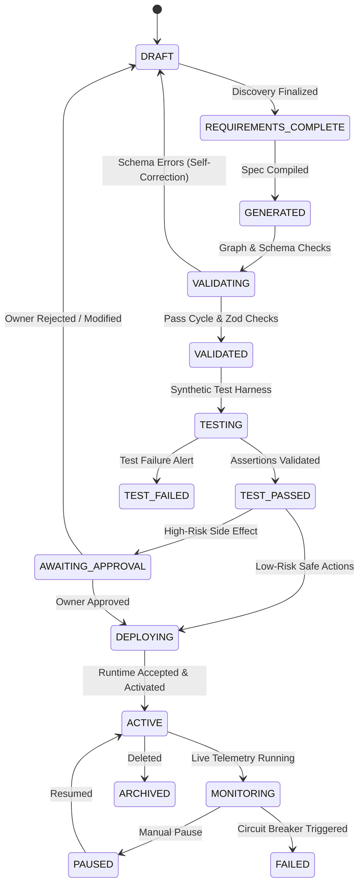

# QuickReply AI Automation Operating System — Runtime Deployment & Orchestration Design

**Document Version:** 2.0  
**Specification:** Execution Provider Abstraction, n8n, LangGraph & Native Runtimes  

---

## 1. Pluggable Runtime Architecture (`IExecutionProvider`)

To ensure commercial compliance, legal isolation, and architectural resilience, QuickReply does not hardcode workflow execution to any single engine. All runtime interactions occur through a unified provider contract:

```typescript
export interface DeploymentResult {
  deploymentId: string;
  provider: "n8n" | "langgraph" | "native";
  version: number;
  status: "ACTIVE" | "INACTIVE";
  externalWorkflowId?: string;
  webhookUrl?: string;
  deployedAt: string;
}

export interface IExecutionProvider {
  providerId: "n8n" | "langgraph" | "native";
  deploy(spec: WorkflowSpec, credentials: Record<string, any>): Promise<DeploymentResult>;
  executeDryRun(spec: WorkflowSpec, testInputs: Record<string, any>): Promise<TestExecutionResult>;
  activate(deploymentId: string): Promise<boolean>;
  deactivate(deploymentId: string): Promise<boolean>;
  getExecutionLogs(executionId: string): Promise<ExecutionStepTrace[]>;
}
```

---

## 2. Runtime Providers Specification

### 2.1 n8n Execution Adapter (`N8nExecutionProvider`)
- **Use Cases:** Deterministic multi-app integrations, cron schedules, Google Workspace, Telegram, Slack, Webhook routers.
- **Workflow Generation:** Compiles `WorkflowSpec v2.0` into the official n8n workflow schema:
  - `nodes`: Array of `{ parameters, id, name, type, typeVersion, position }`.
  - `connections`: Map of node output keys to input arrays.
- **API Interactions:** Connects via authenticated REST client (`/api/v1/workflows`, `/api/v1/workflows/:id/activate`).
- **Commercial Licensing Isolation:** Hosted as an external execution worker; QuickReply’s proprietary compiler, chat UI, and multi-tenant security layers sit in front. If licensing requires, the customer can bring their own n8n instance or switch seamlessly to the Native or LangGraph providers with zero workflow schema redesign.

### 2.2 LangGraph Execution Adapter (`LangGraphExecutionProvider`)
- **Use Cases:** Stateful reasoning agents, long-running dynamic tasks, multi-agent debate, human-in-the-loop interruptions, self-healing automations.
- **State Serialization:** LangGraph State is snapshotted into MongoDB `agentThreads` with durable checkpointing after every node execution.
- **Interruption Primitive:** When an action with `sideEffect: "FINANCIAL"` or `sideEffect: "EXTERNAL_COMMUNICATION"` is reached, LangGraph emits an `INTERRUPT` signal, persists the thread checkpoint, and waits for the Human Approval decision.

### 2.3 Native DAG Execution Adapter (`NativeExecutionProvider`)
- **Use Cases:** Built-in zero-dependency execution fallback directly inside QuickReply’s Node.js / BullMQ cluster.
- **Execution Engine:** Utilizes `src/backend/workflows/WorkflowEngine.ts` and `src/backend/workflows/NodeRegistry.ts`.
- **Topological Traversal:** Validates DAG acyclicity via DFS and executes sequentially or concurrently along branch handles.

### 2.4 Hybrid Orchestration Pattern
```
[User Trigger Event]
         │
         ▼
[LangGraph Agentic Brain] ──> Needs Dynamic Decision / Research / Classification
         │
         ├──> [Decision: Invoice Verified, Category = Enterprise, Priority = High]
         │
         ▼
[Delegation to n8n Runtime] ──> Executes deterministic external writes
                                 ├──> Append row to Google Sheet
                                 └──> Dispatch Telegram Alert
```

---

## 3. Safe Deployment State Machine

No workflow transitions from `GENERATED` to `ACTIVE` without completing the formal deployment lifecycle:



---

## 4. Rollback & Versioning Strategy

1. **Immutable Versions:** Every publish operation increments `version` (e.g., v1, v2, v3) and archives previous definitions in `workflow_versions`.
2. **Instant Rollback:** A user or automated health monitor can trigger `POST /api/workflows/:id/rollback?version=N`, which restores version $N$, deactivates the unstable runtime deployment, and activates the proven version in $< 500\text{ms}$.